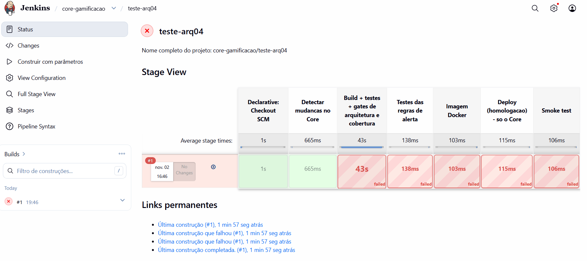

# Checklist de prints (evidências visuais)

As evidências em texto (`evidencias/desafio-0X/*.txt`) foram geradas rodando os labs de verdade. Os prints abaixo dependem da stack Docker, do Jenkins e do Grafana rodando na máquina da equipe. Salve cada imagem com o nome indicado e cole a linha de Markdown no README, na seção do desafio.

Pré-requisito: `cd gamificacao-ead && docker compose up -d --build`

## Desafio 1
- [ ] `evidencias/desafio-01/swagger-ranking.png`: Swagger → `GET /ranking` com 3 alunos ordenados.

## Desafio 2
- [ ] `evidencias/desafio-02/perfil-memoria-log.png`: terminal do `mvn spring-boot:run -Dspring-boot.run.profiles=memoria` mostrando `Porta AlunoRepositorio -> adapter EM MEMORIA`.

## Desafio 3
- [ ] `evidencias/desafio-03/ia-parada-recomendacao.png`: com `docker compose stop ia-service`, Swagger → `GET /alunos/{id}/recomendacoes` mostrando `degradado: true`.

## Desafio 4
- [ ] `evidencias/desafio-04/outbox-pendente.png`: com `docker compose stop notificacao-stub`, `GET /eventos/outbox` mostrando `PENDENTE` com tentativas.
- [ ] `evidencias/desafio-04/sincrono-500.png`: parte B do lab (500 na conclusão).

## Desafio 5
- [ ] `evidencias/desafio-05/gateway-sessao-retomada.png`: `docker compose logs iot-gateway` com `sessao retomada=True` e o backoff.

## Desafio 6 (essenciais)
- [ ] `evidencias/desafio-06/jenkins-3-jobs.png`: tela inicial do Jenkins com os 3 jobs (`core-gamificacao`, `ia-service`, `iot-gateway`).
- [ ] `evidencias/desafio-06/jenkins-core-verde.png`: Stage View do Core todo verde, até *Smoke test*.
- [ ] `evidencias/desafio-06/jenkins-core-bloqueado-arq04.png`: numa branch de teste, acrescente `import jakarta.persistence.Entity;` + `@Entity` em `gamificacao/domain/Aluno.java` e faça push. O stage *Build + testes + gates* fica vermelho, os stages de deploy não rodam, e o console mostra `ARQ-04 … Dominio acoplado`. Depois apague a branch.
- [ ] `evidencias/desafio-06/jenkins-ia-service-sozinho.png`: altere só `servicos/ia-service/app/recomendacao.py` (ex.: `MODELO_VERSAO`); o job `ia-service` roda e o `core-gamificacao` fica `NOT_BUILT`.
- [ ] `evidencias/desafio-06/prometheus-targets.png`: http://localhost:9090/targets com os 3 jobs `UP`.
- [ ] `evidencias/desafio-06/grafana-normal.png`: dashboard "Arquitetura B1" com tráfego normal.
- [ ] `evidencias/desafio-06/grafana-ia-parada.png` e `prometheus-alertas-firing.png`: durante a parte 3 de `bash labs/desafio-06/executar-lab.sh` (`IaDegradada` e `ComponenteFora` FIRING).
- [ ] `evidencias/desafio-06/grafana-recuperado.png` e `prometheus-alertas-resolvidos.png`: parte 4 do mesmo script.

Linha para colar no README (exemplo):

```markdown

```
