# Registro Arquitetural — Exercício B1 (Architecture Lab)

**Disciplina:** DevOps & QA (Facens) · **Produto:** Gamificação para Engajamento de Educação Continuada (evolução da AC1)

| Integrante | RA |
|---|---|
| Kaique Vecchia Alves | 235446 |
| Micael Teodoro de Almeida | 234941 |
| Nathalia Atamanchuk Baleeiro | 235215 |

Este arquivo é o **registro cumulativo** dos seis desafios. Cada desafio segue a mesma cadeia e pode ser lido de trás para frente:

`RF → RNF (FURPS+) → ASR + RPC → Alternativas/trade-offs → ADR → C4 → Evidência`

## Sumário

- [Linha de base: o que a AC1 entregou](#linha-de-base-o-que-a-ac1-entregou)
- [Requisitos funcionais do B1](#requisitos-funcionais-do-b1)
- [Matriz cumulativa de ASRs](#matriz-cumulativa-de-asrs)
- [RPCs consolidadas](#rpcs-consolidadas)
- [Índice de ADRs](#índice-de-adrs)
- [Desafio 1 — Drivers e evolução do Core](#desafio-1--drivers-e-evolução-do-core)
- [Desafio 2 — Organização interna do Core](#desafio-2--organização-interna-do-core)
- [Desafio 3 — Serviço Python e IA](#desafio-3--serviço-python-e-ia)
- [Desafio 4 — Comunicação e eventos](#desafio-4--comunicação-e-eventos)
- [Desafio 5 — IoT e MQTT](#desafio-5--iot-e-mqtt)
- [Desafio 6 — CI/CD e observabilidade](#desafio-6--cicd-e-observabilidade)
- [C4 final — Container](#c4-final--container)
- [Achados dos labs](#achados-dos-labs)
- [Como executar](#como-executar)
- [Síntese final: o que vai para a PoC da Avaliação Final](#síntese-final-o-que-vai-para-a-poc-da-avaliação-final)

---

## Linha de base: o que a AC1 entregou

| Item | Estado na AC1 (branch `main`) |
|---|---|
| Estilo | Monólito em camadas: `aluno/{web, service, repository, dto, domain}` |
| Regras | RN1–RN5 concentradas na entidade JPA `Aluno` (curso > 7,0 libera 3 cursos; 12 conquistas → Premium; moedas; fórum) |
| Dados | Tabela `aluno` (H2 em dev, PostgreSQL no Docker) |
| Qualidade | 38 testes (JUnit + Mockito + Cucumber), Jacoco 100% de linhas e branches |
| Operação | `docker-compose` com app + PostgreSQL + pgAdmin; front Vue estático em `/index.html` |

## Requisitos funcionais do B1

| RF | Descrição | Desafios |
|---|---|---|
| RF01 | Ranking de alunos (cursos conquistados, depois moedas) | 1, 2, 6 |
| RF02 | Conquistas e regras de gamificação (cursos liberados, Premium, moedas, fórum) | 1, 2, 4 |
| RF03 | Recomendação inteligente de cursos | 3 |
| RF04 | Assistente educacional (RAG/LLM) | 3 |
| RF05 | Notificações | 4 |
| RF06 | Receber eventos IoT dos laboratórios e encaminhá-los à plataforma | 5 |

## Matriz cumulativa de ASRs

FURPS+: **F** funcionalidade · **U** usabilidade · **R** confiabilidade · **P** desempenho · **S** suportabilidade (manutenibilidade, testabilidade, modificabilidade) · **+** restrições de implantação/operação.

| ASR | Qualidade (FURPS+) | Desafio | Cenário mensurável | Muda | ADR | Evidência |
|---|---|---|---|---|---|---|
| ASR-01 | Manutenibilidade (S) | 1 | Um RF novo de ranking entra sem alterar pacotes usados pelo RF02 | Estrutura | ADR-001 | Alt. A toca 4 pacotes compartilhados; Alt. B toca 0 (só cria `ranking.*`) |
| ASR-02 | Desempenho (P) | 1 | Ranking de 100 mil alunos responde lendo no máximo 100 linhas por requisição | Dados | ADR-001 | `ORDER BY … LIMIT` no banco + índice `idx_aluno_ranking`; `CT-RNK-02` |
| ASR-03 | Complexidade operacional (S/+) | 1 | Core continua 1 artefato, 1 banco e 1 pipeline | Implantação | ADR-001 | Um único `app` no `docker-compose` |
| ASR-04 | Modificabilidade (S) | 2 | Regra de gamificação muda tocando só `gamificacao.domain`; domínio com 0 imports de framework | Estrutura | ADR-002 | ARQ-04 verde; violação proposital quebra o build |
| ASR-05 | Testabilidade (S) | 2 | Casos de uso testados sem Spring/banco/mocks; adapter trocável sem alterar regra | Estrutura | ADR-002 | CTR-01..05 nos 2 adapters; 0 mocks em CT-SRV |
| ASR-06 | Tolerância a falhas (R) | 3 | IA lenta/parada/5xx: recomendação degradada em ≤ 0,8 s, assistente 503 em ≤ 3 s, conclusão de curso 100% disponível | Comunicação | ADR-003 | Lab: 0,81 s / 3,01 s / conclusão 200 com IA parada |
| ASR-07 | Deploy independente (S/+) | 3 | Modelo novo publicado sem redeploy do Core | Implantação | ADR-003 | Container `ia-service` próprio; versão do modelo na resposta |
| ASR-08 | Escalabilidade (P) | 3 | Carga da IA escala em réplicas próprias, sem replicar Core e banco | Implantação | ADR-003 | Serviço separado no `docker-compose` |
| ASR-09 | Disponibilidade (R) | 4 | Conclusão responde 200 com o provedor de notificação fora | Comunicação | ADR-004 | Lab: 3 × 200 com provedor parado; síncrono deu 500 |
| ASR-10 | Consistência (R) | 4 | Conclusão + recompensa + evento na mesma transação; 0 eventos órfãos ou perdidos | Dados | ADR-004 | EVT-01/02 (rollback não deixa evento) |
| ASR-11 | Recuperabilidade (R) | 4 | Retidos entregues quando o consumidor volta, sem duplicar; DLQ reprocessável | Operação | ADR-004 | 3 retidas → 3 entregues, 0 duplicadas; EVT-04/05 |
| ASR-12 | Conectividade intermitente (R) | 5 | Queda de dispositivo, gateway ou Core: 0 eventos QoS 1 perdidos; duplicata sem efeito | Comunicação | ADR-005 | Lab: 12 publicados → 12 armazenados; 1 duplicata absorvida |
| ASR-13 | Eficiência de comunicação (P) | 5 | Conexão persistente; payload ≤ 100 B por evento | Comunicação | ADR-005 | 89 B por evento; teste `payload < 100` |
| ASR-14 | Interoperabilidade (F/+) | 5 | Core recebe contrato único e não conhece MQTT nem formato de fabricante | Estrutura | ADR-005 | Gateway traduz; módulo `iot` só recebe HTTP |
| ASR-15 | Deploy independente (S/+) | 6 | Mudança num componente roda só o pipeline dele e recria só o container dele | Implantação | ADR-006 | 3 Jenkinsfiles com detecção de mudança + `--no-deps` |
| ASR-16 | Confiabilidade da entrega (R) | 6 | Teste, regra de arquitetura, cobertura do domínio, regra de alerta ou smoke falhando bloqueiam o deploy; smoke falho → rollback | Operação | ADR-006 | ARQ-04 quebra o build; `promtool test rules` verde |
| ASR-17 | Observabilidade (S/+) | 6 | Todo ASR crítico com métrica + alerta no limiar do ADR | Operação | ADR-006 | 6 alertas anotados com ADR; `ComponenteFora` e `IaDegradada` dispararam e resolveram no lab |

## RPCs consolidadas

| RPC | Tipo | Desafios |
|---|---|---|
| Core em Java 17 / Spring Boot 3 | Tecnologia / legado | 1, 2, 3 |
| Equipe de 6 desenvolvedores | Equipe | 1 |
| Banco relacional e legado da AC1 (tabela `aluno`, endpoints `/alunos` usados pelo front) | Legado / dados | 1, 2 |
| Reaproveitar regras existentes; não reescrever o produto para aplicar padrão | Legado | 2 |
| ML/RAG implementados em Python | Tecnologia | 3 |
| Indisponibilidade de IA ou de consumidor externo não bloqueia o fluxo essencial | Premissa de negócio | 3, 4 |
| Broker de mensagens adiciona custo operacional | Infraestrutura | 4, 5 |
| Dispositivos com baixo poder computacional e conectividade intermitente | Integração / infraestrutura | 5 |
| Jenkins na esteira; Prometheus/Grafana no laboratório; artefatos e configurações versionados | Infraestrutura | 6 |

## Índice de ADRs

| ADR | Título | Status |
|---|---|---|
| [ADR-001](#adr-001--evoluir-o-core-para-monólito-modular) | Evoluir o Core para Monólito Modular | Aceito |
| [ADR-002](#adr-002--ports--adapters-hexagonal-no-módulo-gamificação-com-domínio-ddd-puro) | Ports & Adapters no módulo Gamificação | Aceito |
| [ADR-003](#adr-003--ia-como-serviço-python-independente-com-fronteiras-separadas-para-ml-e-rag-no-core) | IA como serviço Python independente | Aceito |
| [ADR-004](#adr-004--conclusão-síncrona--eventos-via-transactional-outbox-no-banco-sem-broker-por-enquanto) | Conclusão síncrona + Transactional Outbox (sem broker) | Aceito |
| [ADR-005](#adr-005--mqtt-qos-1-sessão-persistente--iot-gateway-como-camada-anticorrupção-core-idempotente-sem-segundo-broker) | MQTT + iot-gateway; Core idempotente; sem segundo broker | Aceito |
| [ADR-006](#adr-006--pipeline-jenkins-por-componente-com-gates-arquiteturais--métricas-e-alertas-ligados-aos-adrs) | Pipeline por componente + alertas ligados aos ADRs | Aceito |

---

## Desafio 1 — Drivers e evolução do Core

**Cenário:** o MVP sai de 1.000 para até 100.000 usuários; o ranking cresce mais que o resto; cursos, conquistas e recompensas continuam evoluindo. Manter camadas, ir para monólito modular ou separar serviços?

### 1. RF

- **RF01 Ranking** — novo no B1: `GET /ranking?pagina=0&tamanho=10`.
- **RF02 Conquistas** — já existente (RN2–RN5 da AC1), continua evoluindo.

### 2. RNF (FURPS+)

| RNF | FURPS+ | Leitura no case |
|---|---|---|
| Manutenibilidade | S | Regras de gamificação mudam com frequência e agora dividem o código com o ranking |
| Desempenho | P | O ranking é a leitura que mais cresce; não pode carregar 100 mil alunos em memória |
| Escalabilidade | P | Usuários × 100 |
| Testabilidade | S | Já alta na AC1 (100% Jacoco); aprofundada no Desafio 2 |
| Complexidade operacional | S/+ | Equipe de 6 pessoas precisa operar o que construir |

### 3. ASR (máx. 3)

| ASR | O que ele muda na arquitetura |
|---|---|
| **ASR-01 Manutenibilidade** | **Estrutura:** o código passa a ser agrupado por capacidade de negócio (módulo), não por tipo técnico, para que mexer no ranking não mexa nos pacotes do RF02. |
| **ASR-02 Desempenho do ranking** | **Dados:** ordenação e corte (top N) saem da aplicação e vão para o banco, com índice nas colunas de ordenação. |
| **ASR-03 Complexidade operacional** | **Implantação/operação:** limita a solução a 1 artefato e 1 pipeline enquanto não houver necessidade comprovada de deploy separado. |

**Por que escalabilidade e testabilidade não viraram ASR aqui:** o Core é *stateless* e escala por réplicas atrás de um balanceador; com o top N resolvido no banco, 100× usuários aumenta a carga mas **não muda a estrutura**. Testabilidade já está atendida e só passa a dirigir decisão no Desafio 2.

### 4. RPC

- Core em Java 17 / Spring Boot 3 (não se troca a stack).
- Equipe de 6 desenvolvedores.
- Banco relacional e legado da AC1: tabela `aluno` e endpoints `/alunos` consumidos pelo front Vue precisam continuar funcionando.

### 5. Decisão do Tech Lead

- **Quais RNFs viram ASR?** Manutenibilidade, desempenho do ranking e complexidade operacional.
- **Há necessidade comprovada de escala ou deploy independente?** **Não.** O ranking cresce em *leitura*, e leitura se resolve com consulta paginada + índice + réplicas do mesmo artefato. Não existe cadência de entrega diferente para o ranking nem time separado cuidando dele.
- **A complexidade distribuída é justificável?** **Não agora.** Um serviço de ranking traria rede no caminho, consistência eventual entre moedas e posição, mais um banco ou réplica, mais um pipeline e monitoramento — custo alto para uma equipe de 6 sem um ASR que o pague. O gatilho para rever está nas consequências do ADR-001.

### 6. Alternativas e trade-offs

| Critério | A. Monólito em Camadas | **B. Monólito Modular** | C. Serviço de Ranking |
|---|---|---|---|
| ASR-01 Manutenibilidade | Baixa: ranking espalhado em `web/service/repository/dto`, ao lado do RF02 | **Alta: tudo em `ranking/`, fronteira verificada no build** | Alta (fronteira física) |
| ASR-02 Desempenho | Atende (top N no banco) | **Atende (top N no banco + índice)** | Atende, com escala isolada |
| ASR-03 Complexidade operacional | Baixa | **Baixa (1 artefato)** | Alta (2 deploys, rede, observabilidade distribuída) |
| Consistência moedas × ranking | Transação local | **Transação local** | Eventual |
| Custo de migração | Nenhum | **Médio (reorganizar pacotes)** | Alto |
| Risco principal | Acoplamento cresce a cada RF | Fronteira lógica pode ser furada sem regra automática | Sistema distribuído sem necessidade |

A alternativa A foi efetivamente escrita (só os arquivos que ela acrescentaria) em [`labs/desafio-01/alternativa-a-camadas/`](../../labs/desafio-01/alternativa-a-camadas/) para que a comparação fosse medida, e não opinada.

### 7. Mini-lab / evidência

**Hipótese:** organizar por módulo de negócio permite incluir o RF01 sem acoplar o ranking às classes do RF02, e essa fronteira pode ser **verificada automaticamente**.

**Como reproduzir:** `python labs/desafio-01/analisar_dependencias.py …` (instruções no cabeçalho do script). Relatório completo: [`evidencias/desafio-01/comparacao-dependencias.md`](evidencias/desafio-01/comparacao-dependencias.md).

| Métrica | AC1 (antes) | Alt. A: ranking em camadas | **Alt. B: monólito modular** |
|---|---:|---:|---:|
| Classes / pacotes | 13 / 6 | 16 / 6 | 19 / 9 |
| Pacotes tocados pelo RF01 | — | **4, todos compartilhados com o RF02** | **3, todos novos (`ranking.*`)** |
| Arquivos existentes alterados pelo RF01 | — | 1 (`AlunoRepository` ganha a query do ranking) | 1 (`Aluno` ganha só a anotação do índice) |
| Classes do ranking que importam a entidade JPA `Aluno` | — | 3 | **0** |
| Imports apontando para o pacote da entidade (`*.domain`) | 9 | 12 | 9 (nenhum vindo do ranking) |
| Dependências entre módulos de 1º nível | — | — | **0** |
| Fronteira verificada no build | Não | Não | **Sim** (`ArquiteturaModularTest`, ARQ-01..03) |

| Antes (AC1) | Alternativa A | Alternativa B (escolhida) |
|---|---|---|
| 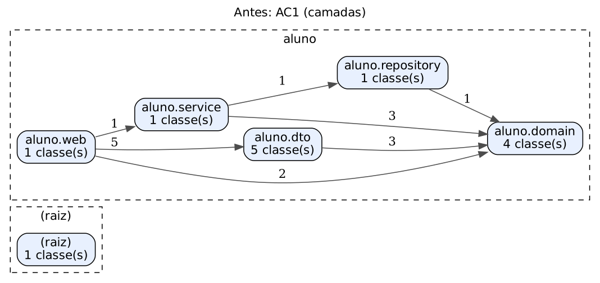 | 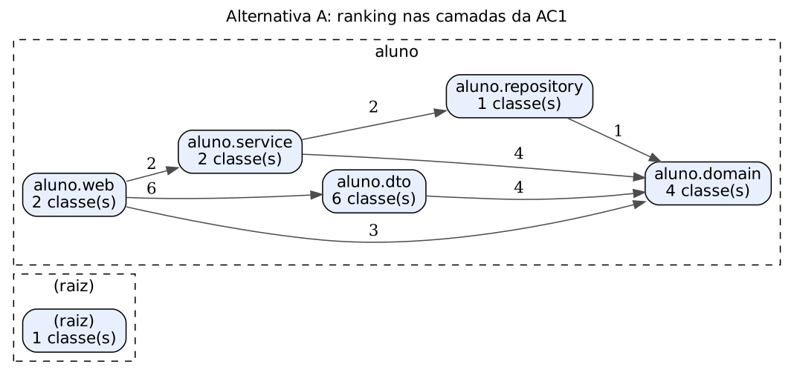 | 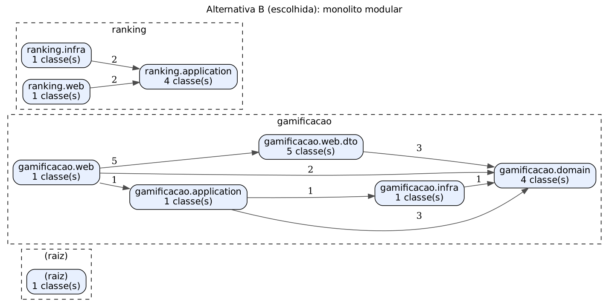 |

**Testes que sustentam a decisão:**

- `ArquiteturaModularTest` — ARQ-01 (módulos só usam o subpacote `api` de módulos declarados), ARQ-02 (todo pacote de 1º nível é um módulo declarado) e ARQ-03 (o verificador detecta uma violação sintética, provando que a regra não é decorativa). Implementado só com a JDK, sem ArchUnit.
- `RankingServiceTest` — CT-RNK-01..03: numeração entre páginas e **tamanho máximo de 100** por requisição (ASR-02).
- `RankingIntegracaoTest` — CT-RNK-04: dados entram pelo módulo Gamificação e saem pelo Ranking no H2 real, na ordem correta.

**Resultado:** a hipótese se confirmou. Na alternativa A o ranking passa a depender da entidade JPA e divide quatro pacotes com o RF02; na B ele não importa nenhuma classe do RF02. O preço é um **acoplamento de schema** (o ranking lê 5 colunas da tabela `aluno` via SQL), registrado como trade-off.

### 8. ADR + C4

#### ADR-001 — Evoluir o Core para Monólito Modular

- **Status:** Aceito.
- **Contexto:** crescimento para 100 mil usuários; ranking com carga crescente de leitura; regras de gamificação em evolução; AC1 organizada por camada técnica dentro de um único pacote `aluno`.
- **ASRs/RPCs:** ASR-01, ASR-02, ASR-03 · Java/Spring Boot, equipe de 6, legado da AC1.
- **Alternativas:** A — manter camadas; B — monólito modular; C — serviço de ranking.
- **Decisão:** B. O Core vira um monólito modular com módulos por capacidade (`gamificacao`, `ranking`; os desafios seguintes acrescentam outros). Cada módulo só expõe o subpacote `api`; as dependências permitidas ficam declaradas em `ArquiteturaModularTest` e são checadas a cada build. O ranking resolve o top N no banco (`ORDER BY … LIMIT/OFFSET`) com índice `idx_aluno_ranking` e página máxima de 100.
- **Consequências:**
  - (+) RF01 entrou sem tocar nos pacotes do RF02; regra de fronteira automática.
  - (+) 1 artefato, 1 banco, transação local — custo operacional igual ao da AC1.
  - (+) se um dia o ranking precisar sair, só `RankingJdbc` é trocado.
  - (−) **tabela compartilhada:** o ranking conhece 5 colunas de `aluno`. Mitigação: uma única classe (`RankingJdbc`) concentra esse conhecimento.
  - (−) escalar o ranking significa escalar o Core inteiro.
  - **Gatilho para reavaliar (C):** p95 do `GET /ranking` acima de 300 ms com réplicas e índice, ou necessidade de cadência de deploy própria para o ranking. A métrica entra no Desafio 6.

#### C4 — Container (após o Desafio 1)

A decisão é **interna ao Core**: no nível Container nada muda além do Core passar a ter módulos. O detalhe dos módulos fica no C4 Component do Desafio 2.

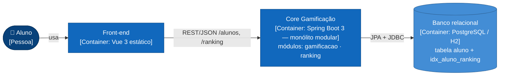

**Rastreabilidade:** RF01/RF02 → manutenibilidade, desempenho, complexidade operacional → ASR-01/02/03 + RPCs → B vence A (acoplamento) e C (custo operacional) → ADR-001 → C4 Container → comparação de dependências + ARQ-01..03 + CT-RNK-01..04.

---

## Desafio 2 — Organização interna do Core

**Cenário:** regras de ranking, moedas, badges e recompensas mudam com frequência. Domínio, banco, framework e integrações não podem ficar fortemente acoplados.

### 1. RF

RF01 Ranking; RF02 Conquistas e regras de gamificação (RN1–RN5).

### 2. RNF (FURPS+)

| RNF | FURPS+ | Situação na AC1 |
|---|---|---|
| Manutenibilidade | S | Regra e mapeamento JPA na mesma classe (`Aluno` era `@Entity`) |
| Testabilidade | S | O teste do caso de uso precisava mockar o `JpaRepository` do Spring Data |
| Modificabilidade | S | Trocar a forma de persistir obrigaria a editar a classe que contém as regras |
| Facilidade de evolução | S | Novas regras (badges, recompensas) cairiam na mesma classe-entidade |

### 3. ASR (máx. 3)

| ASR | O que ele muda na arquitetura |
|---|---|
| **ASR-04 Modificabilidade** | **Estrutura:** a regra fica num domínio sem JPA nem Spring; mudar uma regra não toca persistência, e mudar a persistência não toca a regra. |
| **ASR-05 Testabilidade** | **Estrutura/dependências:** o caso de uso depende de uma *porta*; nos testes ela é atendida por um adapter em memória, sem Spring, banco ou Mockito. |

Manutenibilidade e facilidade de evolução não viraram ASR novos: já estão cobertas por ASR-01 (módulos) e ASR-04.

### 4. RPC

- O Core continua Spring Boot.
- As regras existentes devem ser reaproveitadas: RN1–RN5 e os cenários BDD da AC1 continuam passando sem alteração de comportamento.
- Não é permitido reescrever o produto só para aplicar um padrão.

### 5. Decisão do Tech Lead

- **Qual dependência realmente precisa ser invertida?** A de **persistência**. Na AC1 o domínio *era* a entidade JPA e o service dependia de `JpaRepository`. Agora: `GamificacaoService → AlunoRepositorio (porta) ← AlunoRepositorioJpa | AlunoRepositorioEmMemoria`. A dependência HTTP já apontava para dentro (controller → caso de uso) e foi mantida. A **transação** continua com `@Transactional` do Spring na camada de aplicação: inverter isso também custaria mais do que protege.
- **O custo estrutural é proporcional?** Só no módulo `gamificacao`, onde as regras mudam. Foram criadas 7 classes (porta, 2 adapters, entidade JPA, repositório Spring Data, `EstadoDoAluno` e `CriterioDoForum`) e **nenhum método de regra foi reescrito**: o diff de `Aluno` só remove anotações e acrescenta `reconstituir`/`estado`. O módulo `ranking` continua fino, já com sua porta `LeituraDoRanking`.
- **DDD, Hexagonal, Clean e Onion são concorrentes?** Não. Hexagonal, Clean e Onion expressam a **mesma regra de dependência** (de fora para dentro) com vocabulários diferentes; usamos o da Hexagonal (porta/adapter). O DDD tático dá o modelo que fica no centro: agregado `Aluno`, política `CriterioDoForum` e exceção de domínio; o Desafio 4 acrescenta evento de domínio. Não adotamos a cerimônia completa da Clean (um *interactor* por caso de uso, *presenters*): custo desproporcional para uma equipe de 6.

### 6. Alternativas e trade-offs

| Critério | A. Camadas atuais (entidade = domínio) | **B. Ports & Adapters no módulo Gamificação** | C. Clean/Onion completa em todos os módulos |
|---|---|---|---|
| ASR-04 Modificabilidade | Baixa: regra presa a anotações JPA | **Alta: domínio puro, verificado (ARQ-04)** | Alta |
| ASR-05 Testabilidade | Média: precisa de mock do Spring Data | **Alta: adapter em memória + teste de contrato** | Alta |
| Classes novas | 0 | **7, num único módulo** | ~25 (porta, *interactor* e *presenter* por caso de uso) |
| Mapeamento domínio ↔ JPA | Nenhum | **1 conversão via `EstadoDoAluno`** | Em todos os módulos |
| Risco | Regra e banco evoluem juntos | Adapters divergirem → mitigado pelo **teste de contrato** | Burocracia, sem ganho nos módulos simples |

### 7. Mini-lab / evidência

**Hipótese:** isolando a regra atrás de uma porta, é possível **trocar o adapter de persistência** (JPA ↔ memória) **sem alterar** domínio, caso de uso ou API, e os testes do domínio continuam valendo.

| Evidência | Resultado | Arquivo |
|---|---|---|
| Teste de contrato da porta (`ContratoAlunoRepositorio`) rodando nos **dois** adapters | CTR-01..05 verdes em `AlunoRepositorioEmMemoriaTest` **e** `AlunoRepositorioJpaTest` (H2 real) | [`testes-desafio-02.txt`](evidencias/desafio-02/testes-desafio-02.txt) |
| Casos de uso sem Spring, banco ou Mockito | CT-SRV-01..08 usando `AlunoRepositorioEmMemoria` | idem |
| Mesmo fluxo pela API com cada adapter (`labs/desafio-02/executar-lab.sh`) | Respostas idênticas; única diferença: o ranking, que lê a tabela por SQL | [`api-perfil-default.txt`](evidencias/desafio-02/api-perfil-default.txt), [`api-perfil-memoria.txt`](evidencias/desafio-02/api-perfil-memoria.txt), [`diff-jpa-x-memoria.txt`](evidencias/desafio-02/diff-jpa-x-memoria.txt) |
| Regra automática do domínio puro | `@Entity` recolocado em `Aluno` → **ARQ-04 falha** e o build quebra | [`arq-04-violacao-dominio.txt`](evidencias/desafio-02/arq-04-violacao-dominio.txt) |

| Métrica | AC1 | B1 (Desafio 2) |
|---|---:|---:|
| Imports `jakarta.persistence` na classe de regras | 6 | **0** |
| Mocks no teste do caso de uso | 1 (`JpaRepository`) | **0** |
| Linhas alteradas em domínio/aplicação/API para trocar o adapter | — | **0** (só o perfil `memoria`) |
| Testes da suíte | 38 | 57 |

**Achado do lab:** o perfil `memoria` deixou o ranking vazio. Isso **confirma** o trade-off do ADR-001: o ranking depende do schema, não da porta. Ficou registrado como gatilho para o Desafio 4 (projeção do ranking alimentada por eventos), e não como defeito a esconder.

### 8. ADR + C4

#### ADR-002 — Ports & Adapters (Hexagonal) no módulo Gamificação, com domínio DDD puro

- **Status:** Aceito.
- **Contexto:** regras de gamificação mudam com frequência; na AC1 a classe de regras era a entidade JPA e os testes do caso de uso dependiam do Spring Data.
- **ASRs/RPCs:** ASR-04, ASR-05 · Spring Boot mantido, regras reaproveitadas, sem reescrita.
- **Alternativas:** A — manter camadas; B — Ports & Adapters no módulo que muda; C — Clean/Onion completa em todo o Core.
- **Decisão:** B. `gamificacao.domain` sem framework (ARQ-04); `gamificacao.application` depende só de portas (ARQ-05); adapters em `gamificacao.adapter.{web, persistence, memoria}`. O adapter é escolhido por perfil Spring (`!memoria` → JPA; `memoria` → mapa). Um **teste de contrato** único garante que todos os adapters se comportam igual.
- **Consequências:**
  - (+) regras testáveis em milissegundos, sem contexto Spring; troca de persistência sem tocar na regra.
  - (+) o mesmo padrão é o "molde" para os adapters de IA (D3), eventos (D4) e IoT (D5).
  - (−) mapeamento domínio ↔ entidade (`EstadoDoAluno`) a cada leitura e escrita.
  - (−) a regra do fórum existe em dois lugares (`CriterioDoForum` no domínio, *query* derivada no adapter JPA). Mitigação: o CTR-04 roda nos dois.
  - (−) `@Transactional` do Spring permanece na aplicação (pragmatismo consciente).

#### C4 — Component do Core (após o Desafio 2)

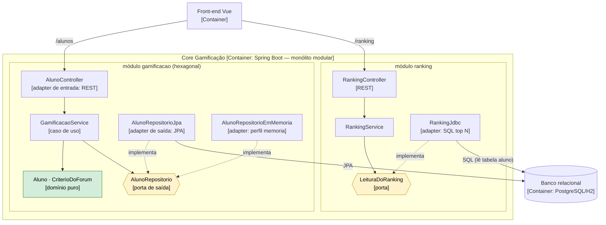

**Rastreabilidade:** RF01/RF02 → modificabilidade, testabilidade → ASR-04/05 + RPCs (Spring, reaproveitar regras) → B vence A (acoplamento à JPA) e C (custo) → ADR-002 → C4 Component → CTR-01..05 nos dois adapters + diff da API + violação ARQ-04.

---

## Desafio 3 — Serviço Python e IA

**Cenário:** a plataforma incorpora recomendação inteligente e assistente educacional. Os modelos são feitos em Python, têm ciclo de atualização próprio e carga variável, e podem ficar indisponíveis sem impedir as operações essenciais do Core.

### 1. RF

- **RF03 Recomendação inteligente** — `GET /alunos/{id}/recomendacoes`.
- **RF04 Assistente educacional (RAG)** — `POST /assistente/perguntas`.

### 2. RNF (FURPS+)

| RNF | FURPS+ | Leitura no case |
|---|---|---|
| Deploy independente | S/+ | O modelo é re-treinado e a base do RAG é atualizada em ritmo diferente do Core |
| Escalabilidade | P | Inferência e LLM têm picos próprios (ex.: véspera de prova) |
| Tolerância a falhas | R | A IA vai cair, ficar lenta ou devolver 5xx; o Core não pode cair junto |
| Interoperabilidade | F/+ | Java ↔ Python |
| Desempenho | P | O front não pode esperar indefinidamente pela IA |
| Manutenibilidade | S | Times de dados e de backend evoluem cada lado |

### 3. ASR (máx. 3)

| ASR | O que ele muda na arquitetura |
|---|---|
| **ASR-06 Tolerância a falhas** | **Comunicação:** toda chamada à IA tem timeout por porta e um comportamento degradado definido; nenhuma operação essencial passa pela IA. |
| **ASR-07 Deploy independente** | **Implantação:** a IA vira um container e um pipeline próprios; um modelo novo é publicado sem redeploy do Core. |
| **ASR-08 Escalabilidade** | **Implantação:** a carga variável da IA escala em réplicas do `ia-service`, sem replicar o Core e o banco. |

Interoperabilidade **não** virou ASR: resolve-se com um contrato HTTP/JSON simples, sem afetar a estrutura. Desempenho foi absorvido pelo ASR-06 (o timeout é o limite de latência que o Core aceita).

### 4. RPC

- Core permanece Java / Spring Boot.
- ML e RAG são implementados em Python.
- A indisponibilidade da IA não pode bloquear o fluxo essencial (concluir curso, moedas, ranking).

### 5. Decisão do Tech Lead

- **Python por si só justifica um serviço?** **Não.** A linguagem é uma restrição (RPC), não um driver. O que justifica a fronteira de **processo** são os ASRs: ciclo de deploy próprio (ASR-07), falha isolada — um modelo que trava ou estoura memória não derruba a JVM do Core (ASR-06) — e escala própria (ASR-08).
- **ML e RAG precisam da mesma fronteira?** **Mesmo deployable hoje, fronteiras separadas no Core.** Um único `ia-service` com dois *routers* (mesma stack, mesmo time, um pipeline). No Core, porém, são **duas portas** (`MotorDeRecomendacao`, `AssistenteEducacional`) com clientes, timeouts e degradações diferentes. Separar em dois serviços vira só uma troca de URL. **Gatilho:** adotar um LLM real com custo/latência/GPU diferentes do modelo de recomendação, ou atualizar a base do RAG em cadência própria.
- **Quais ASRs justificam autonomia e escala?** ASR-06, ASR-07 e ASR-08.
- **Qual comportamento degradado é aceitável?**

| Funcionalidade | IA lenta ou fora | Por quê |
|---|---|---|
| Recomendação (RF03) | **200** com catálogo padrão, `degradado=true`, em ≤ 0,8 s | Uma sugestão genérica ainda é útil e o front sabe que é genérica |
| Assistente (RF04) | **503** + `Retry-After: 30`, em ≤ 3 s | Inventar resposta é pior do que não responder |
| Concluir curso, moedas, ranking | **Nenhum impacto** | Não passam pela IA |

### 6. Alternativas e trade-offs

| Critério | A. IA embutida no Core (Java) | B. Módulo acoplado (Python no mesmo deploy, ex.: processo filho/GraalPy) | **C. Serviço Python independente** |
|---|---|---|---|
| RPC "ML/RAG em Python" | **Viola** (reescrever em Java) | Atende, com integração frágil | **Atende** |
| ASR-06 Falha isolada | Não: erro ou memória da IA afeta a JVM | Parcial: mesmo container, mesmo ciclo de vida | **Sim: processo separado + timeout + fallback** |
| ASR-07 Deploy independente | Não | Não (redeploy do Core para trocar modelo) | **Sim (container e pipeline próprios)** |
| ASR-08 Escala própria | Não | Não | **Sim (réplicas do `ia-service`)** |
| Latência | Menor (chamada local) | Baixa | +1 salto de rede (~10–60 ms medidos) |
| Custo operacional | Nenhum novo | Médio (empacotar Python no Core) | **+1 container, +1 pipeline, +1 alvo de monitoramento** |

**ML e RAG juntos ou separados?**

| | **Juntos (um `ia-service`, duas portas no Core)** | Separados (dois serviços) |
|---|---|---|
| Custo hoje | **1 container, 1 pipeline** | 2 de cada |
| Isolamento de falha entre ML e RAG | Parcial (mesmo processo) | Total |
| Mudança futura | **Trocar a URL de uma porta** | — |

### 7. Mini-lab / evidência

**Hipótese:** com o `ia-service` lento ou parado, o Core continua atendendo — recomendação degradada em tempo limitado, assistente com 503 — e o fluxo essencial não é afetado. Quando a IA volta, o Core se recupera **sem restart**.

**Como reproduzir:** `docker compose up -d app ia-service` e depois `bash labs/desafio-03/executar-lab.sh`. O script derruba e religa o `ia-service` sozinho.

Resultado real (FastAPI + Spring Boot rodando, [`lab-ia-indisponivel.txt`](evidencias/desafio-03/lab-ia-indisponivel.txt)):

| Situação da IA | `GET /alunos/{id}/recomendacoes` | `POST /assistente/perguntas` | `POST /alunos/{id}/conclusoes` |
|---|---|---|---|
| No ar | 200 · `origem=IA` · 0,058 s | 200 · 0,011 s | — |
| Lenta (3,5 s) | 200 · **`CATALOGO_PADRAO`, degradado** · **0,81 s** (timeout 0,8 s) | **503** · **3,01 s** (timeout 3 s) | — |
| Parada | 200 · **degradado** · 0,007 s | **503** · 0,005 s | **200 · 0,009 s** |
| Religada | 200 · **`origem=IA`** de novo, sem restart do Core | — | — |

Log do Core com a causa de cada degradação ([`log-core-degradacao.txt`](evidencias/desafio-03/log-core-degradacao.txt)): `SocketTimeoutException - Read timed out` (lenta) e `ConnectException - Connection refused` (parada).

| Testes | O que provam |
|---|---|
| `IaHttpAdapterTest` CT-IA-01..06 | Contra um "ia-service" falso (HttpServer da JDK): resposta normal, 503, lentidão cortada em ~500 ms, serviço desligado e corpo vazio viram `IaIndisponivelException` |
| `RecomendacaoServiceTest` CT-REC-01..04, 07 | Fallback, 503 e contadores de degradação, sem Spring |
| `IaForaDoArIntegracaoTest` CT-REC-05..06 | Core inteiro apontando para uma porta sem IA: **concluir curso funciona** e a recomendação degrada |
| `pytest` no `ia-service` (10 testes) | Contrato, regras do modelo, RAG sem alucinação ("não encontrei") e `/metrics` ([`pytest-ia-service.txt`](evidencias/desafio-03/pytest-ia-service.txt)) |

### 8. ADR + C4

#### ADR-003 — IA como serviço Python independente, com fronteiras separadas para ML e RAG no Core

- **Status:** Aceito.
- **Contexto:** RF03/RF04 em Python, com ciclo de atualização e carga próprios; a IA não pode bloquear o Core.
- **ASRs/RPCs:** ASR-06, ASR-07, ASR-08 · Core Java, IA Python, fluxo essencial independente da IA.
- **Alternativas:** A — IA embutida; B — módulo acoplado; C — serviço independente. ML+RAG juntos × separados.
- **Decisão:** C. Um `ia-service` FastAPI (`/recomendacoes`, `/assistente/perguntas`, `/health`, `/metrics`). No Core, o módulo `recomendacao` tem duas portas atendidas por `IaHttpAdapter` (HTTP/JSON), cada uma com seu timeout (conexão 300 ms; recomendação 800 ms; assistente 3 s) e sua degradação. O módulo lê dados do aluno só pela API pública `gamificacao.api.ConsultaDeAluno` (dependência `recomendacao → gamificacao` declarada no ARQ-01).
- **Consequências:**
  - (+) a IA cai sem derrubar nada essencial; o Core se recupera sozinho quando ela volta.
  - (+) modelo novo = deploy só do `ia-service` (a versão aparece em `modelo` na resposta).
  - (−) +1 container, +1 pipeline, +1 alvo de monitoramento (tratados no Desafio 6).
  - (−) com a IA lenta, **cada** requisição ainda espera o timeout inteiro (0,8 s). **Gatilho:** se `recomendacao_degradada` passar de 5% por 5 min (métrica do D6), adotar *circuit breaker* (Resilience4j) para falhar rápido.
  - (−) o RAG atual é extrativo (sem LLM); plugar um LLM muda só `rag.gerar_resposta`, não o contrato.

#### C4 — Container (após o Desafio 3)

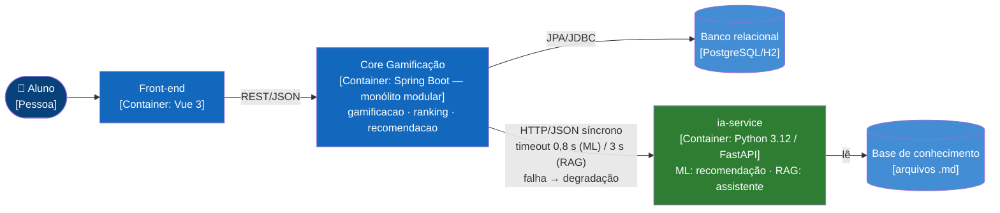

**Rastreabilidade:** RF03/RF04 → tolerância a falhas, deploy independente, escalabilidade → ASR-06/07/08 + RPCs (Python; IA não bloqueia) → C vence A (viola RPC) e B (sem isolamento/deploy) → ADR-003 → C4 Container com protocolo e timeouts → lab com IA lenta/parada/religada + CT-IA/CT-REC.

---

## Desafio 4 — Comunicação e eventos

**Cenário:** ao concluir um curso, o sistema registra a conclusão, calcula recompensas, atualiza informações e pode disparar notificação e analytics. Uma falha de notificação não pode impedir a conclusão do curso.

### 1. RF

- **RF02 Conquistas** — `POST /alunos/{id}/conclusoes` (cursos liberados, Premium, moedas).
- **RF05 Notificações** — aviso ao aluno por um provedor externo (e-mail/push).
- **Eventos de conclusão** — evento `CursoConcluido`, consumido por notificação e por analytics (registro de aprendizagem).

### 2. RNF (FURPS+)

| RNF | FURPS+ | Leitura no case |
|---|---|---|
| Tolerância a falhas | R | O provedor de notificação é de terceiros e cai |
| Disponibilidade | R | Concluir curso é a operação mais importante do produto |
| Latência | P | O aluno precisa ver a recompensa na hora |
| Consistência | R | Recompensa e evento não podem divergir (evento sem conclusão, ou conclusão sem evento) |
| Desacoplamento | S | Novos consumidores (badges, projeção do ranking) não podem exigir mexer na conclusão |
| Recuperabilidade | R | O que ficou retido precisa ser entregue quando o consumidor voltar, sem duplicar |

### 3. ASR (máx. 3)

| ASR | O que ele muda na arquitetura |
|---|---|
| **ASR-09 Disponibilidade da conclusão** | **Comunicação:** só o que precisa ser imediato fica síncrono; notificação e analytics saem do caminho da requisição. |
| **ASR-10 Consistência** | **Dados:** conclusão, recompensa e evento são gravados na **mesma transação** do banco (*transactional outbox*): ou tudo, ou nada. |
| **ASR-11 Recuperabilidade** | **Operação:** a entrega tem retentativa com backoff, fila de falhas definitivas (DLQ) com reprocessamento, e consumidores idempotentes. |

Latência não virou ASR separado: separar o síncrono do assíncrono já mantém a conclusão em ~10 ms. Desacoplamento é consequência do ASR-09 (novo consumidor = novo `AssinanteDeEvento`).

### 4. RPC

- Operações essenciais do Core devem concluir mesmo com consumidor externo indisponível.
- Adotar um broker exige custo operacional (mais um componente para instalar, monitorar, fazer backup e atualizar).

### 5. Decisão do Tech Lead

- **Qual resposta precisa ser imediata?** Registrar a conclusão, calcular a recompensa (+3 cursos, Premium, moedas) e atualizar o aluno (que o ranking lê). Tudo **síncrono, numa transação**, e a resposta HTTP já traz o novo estado.
- **Qual pode ser eventual?** Notificação (segundos) e analytics (segundos a minutos). No futuro: badges externos e uma projeção própria do ranking.
- **Que ASR justificaria mensageria?** ASR-09/10/11 justificam **assincronia durável**, mas não necessariamente um **broker**. Um broker se justifica quando houver vários consumidores **externos** independentes (*fan-out* entre serviços), volume acima do que o banco suporta, ou necessidade de *replay* do histórico. Hoje há 1 consumidor externo e volume baixo.
- **RabbitMQ/Kafka resolvem um problema real do fluxo?** Hoje **não**. Publicar direto no broker dentro da conclusão cria o problema da *escrita dupla* (o commit no banco e a publicação no broker não são atômicos), e a correção para isso é... um outbox. Ou seja, o broker **não elimina** o outbox, só acrescenta um componente. Pelo problema do case:

| | RabbitMQ | Kafka |
|---|---|---|
| Modelo | Filas por consumidor, *push*, DLX nativa | Log particionado e retido, *pull* |
| Resolve bem | Distribuir notificações para N consumidores externos com retentativa | *Replay* do histórico, *streaming* de analytics em alto volume |
| Custo para 6 devs | Médio | Alto (partições, retenção, *consumer groups*) |
| **Gatilho no nosso case** | **2º consumidor externo** (ex.: serviço de badges) → o relay passa a publicar num *exchange* | Analytics fora do Core precisando reprocessar o histórico de eventos |

### 6. Alternativas e trade-offs

| Critério | A. REST síncrono na conclusão | B. Assíncrono em memória (`@Async`) | **C. Outbox no banco + relay** | D. Outbox + broker (RabbitMQ) |
|---|---|---|---|---|
| ASR-09 Conclusão com consumidor fora | **Falha (500) e desfaz a conclusão** (medido) | Atende | **Atende (medido)** | Atende |
| ASR-10 Evento × conclusão atômicos | Sim (mas acoplado) | **Não:** evento perdido se o Core cair | **Sim (mesma transação)** | Sim (com outbox) |
| ASR-11 Retentativa/DLQ/reprocesso | Não | Não | **Sim (backoff, FALHOU_DEFINITIVO, `/reprocessar`)** | Sim (DLX) |
| Latência da conclusão | Soma a do provedor | Baixa | **Baixa (+1 INSERT por assinante)** | Baixa |
| Componentes novos | 0 | 0 | **0 (tabela `outbox_entrega`)** | +1 broker |
| Limite | — | — | Vazão do banco; polling a cada 2 s | Custo operacional |

### 7. Mini-lab / evidência

**Hipótese:** com notificação assíncrona via outbox, desligar o provedor **não afeta** a conclusão; o que ficou retido é entregue quando ele volta, uma única vez. Com a alternativa síncrona, o mesmo cenário **derruba** a conclusão.

**Como reproduzir:** `docker compose up -d app notificacao-stub` e depois `bash labs/desafio-04/executar-lab.sh`. Para a parte B: `EVENTOS_ENTREGA=sincrona docker compose up -d app` e `bash labs/desafio-04/executar-lab.sh sincrono`.

**Parte A — decisão adotada (outbox)** · [`lab-assincrono-consumidor-fora.txt`](evidencias/desafio-04/lab-assincrono-consumidor-fora.txt)

| Momento | Conclusões | Outbox `notificacao.conclusao` | Outbox `analytics.aprendizagem` | Provedor |
|---|---|---|---|---|
| Provedor no ar | 200 em 0,059 s | ENTREGUE (1ª tentativa) | ENTREGUE | recebeu "Curso conquistado: Java" |
| Provedor **parado**, 3 conclusões | **200, 200, 200** (6–12 ms) | **3 PENDENTE**, 3 tentativas cada, backoff | **ENTREGUE** (não espera o outro assinante) | — |
| Provedor **volta** | — | **3 ENTREGUE** na 4ª tentativa | — | recebeu Spring, Docker e Git, **0 duplicadas** |

Retentativas registradas no log do Core: [`log-relay-retentativas.txt`](evidencias/desafio-04/log-relay-retentativas.txt) · Recebimentos no provedor: [`log-provedor-notificacao.txt`](evidencias/desafio-04/log-provedor-notificacao.txt)

**Parte B — alternativa rejeitada (síncrona)** · [`lab-sincrono-consumidor-fora.txt`](evidencias/desafio-04/lab-sincrono-consumidor-fora.txt)

| Momento | Resultado |
|---|---|
| Provedor no ar | 200 (0,134 s, a latência do provedor entra na conclusão) |
| Provedor parado | **HTTP 500**, `ConnectException`, e o aluno continua com 1 curso concluído: **a conclusão foi perdida** |

| Testes (Core) | O que provam |
|---|---|
| `OutboxIntegracaoTest` EVT-01..07, 09 | 1 entrega por assinante na mesma transação; **rollback não deixa evento órfão**; consumidor fora não atrasa o outro; reentrega única com `Idempotency-Key`; DLQ + reprocessamento; agendador |
| `EntregaSincronaTest` EVT-08 | A alternativa A medida em teste: provedor fora → conclusão desfeita |
| `EntregaPendenteTest` EVT-U1 | Backoff 1 s, 2 s, 4 s… com teto, e DLQ ao esgotar |
| `NotificacaoDeConclusaoTest`, CT-SRV-09/10, CT-20 | O evento carrega o resultado da regra; regra violada não publica |
| `pytest` do stub | Provedor idempotente (duplicada → 200, sem novo aviso) |

### 8. ADR + C4

#### ADR-004 — Conclusão síncrona + eventos via Transactional Outbox no banco (sem broker por enquanto)

- **Status:** Aceito.
- **Contexto:** a conclusão de curso precisa responder na hora; notificação depende de um provedor externo que cai; analytics e futuros consumidores precisam do mesmo fato.
- **ASRs/RPCs:** ASR-09, ASR-10, ASR-11 · consumidor externo não bloqueia; broker tem custo operacional.
- **Alternativas:** A — REST síncrono; B — `@Async` em memória; C — outbox + relay; D — outbox + broker.
- **Decisão:** C. `GamificacaoService` publica `CursoConcluido` (contrato em `gamificacao.api`). O módulo `eventos` grava uma linha por assinante em `outbox_entrega` **na mesma transação** e um relay agendado (2 s) entrega, uma entrega por transação, com backoff exponencial (1 s → 60 s), até 8 tentativas e depois `FALHOU_DEFINITIVO`; `POST /eventos/outbox/reprocessar` devolve à fila. Assinantes: `notificacao.conclusao` (webhook com `Idempotency-Key`) e `analytics.aprendizagem` (idempotente por `eventoId`). Garantia: **pelo menos uma vez** + idempotência no consumidor.
- **Consequências:**
  - (+) a conclusão não depende de ninguém externo; zero componentes novos de infraestrutura.
  - (+) novo consumidor = novo bean `AssinanteDeEvento`, sem tocar na conclusão.
  - (+) o relay é o ponto de extensão: trocar "chamar o assinante" por "publicar no RabbitMQ" não muda o produtor.
  - (−) consistência **eventual** (até ~2 s no caminho feliz) para notificação e analytics.
  - (−) *polling* no banco e tabela que cresce. Mitigação: índice `idx_outbox_fila`; expurgo de `ENTREGUE` antigos fica para a AF.
  - (−) com mais de uma instância do Core, dois relays podem pegar a mesma linha. Mitigação: hoje há idempotência no consumidor; para escala horizontal, `SELECT … FOR UPDATE SKIP LOCKED` (PostgreSQL).
  - **Gatilho para D (broker):** 2º consumidor externo, ou mais de ~50 eventos/s sustentados no outbox (métrica no D6).

#### C4 — Container (após o Desafio 4)

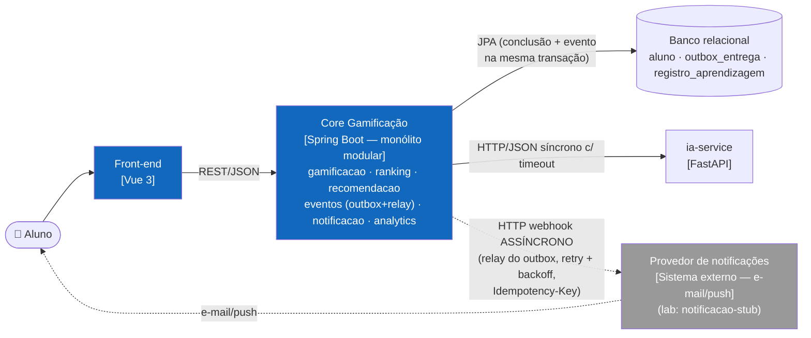

#### Sequência do fluxo crítico

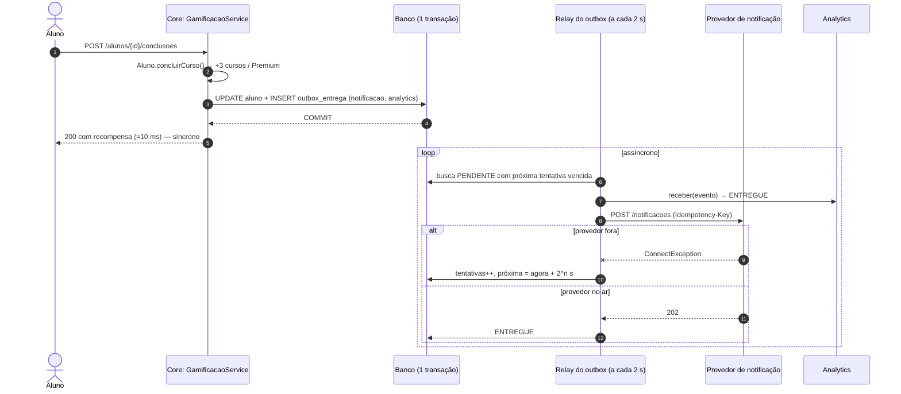

**Rastreabilidade:** RF02/RF05 + eventos → disponibilidade, consistência, recuperabilidade → ASR-09/10/11 + RPCs (consumidor externo não bloqueia; broker custa) → C vence A (derruba conclusão, medido), B (perde evento) e D (componente sem ASR hoje) → ADR-004 → C4 Container + sequência → lab A × B + EVT-01..09.

---

## Desafio 5 — IoT e MQTT

**Cenário:** laboratórios passam a produzir eventos de presença, início e fim de atividades por dispositivos com poucos recursos e conexão instável. Os eventos devem entrar na plataforma sem acoplar o Core a cada dispositivo.

### 1. RF

**RF06** — receber eventos IoT (`PRESENCA`, `INICIO_ATIVIDADE`, `FIM_ATIVIDADE`) e encaminhá-los ao ecossistema da plataforma (registro de aprendizagem e, depois, gamificação).

### 2. RNF (FURPS+)

| RNF | FURPS+ | Leitura no case |
|---|---|---|
| Interoperabilidade | F/+ | Fabricantes e firmwares diferentes; o Core não pode conhecer cada formato |
| Eficiência de comunicação | P | Rádio e CPU limitados: cada byte e cada handshake contam |
| Disponibilidade | R | Os eventos não podem depender de o Core estar no ar naquele segundo |
| Tolerância à conectividade intermitente | R | A rede do laboratório cai; o gateway e o Core também podem cair |
| Escalabilidade | P | Mais bancadas e mais laboratórios |
| Segurança de integração | + | Um dispositivo não pode publicar em nome de outro nem falar direto com o Core |

### 3. ASR (máx. 3)

| ASR | O que ele muda na arquitetura |
|---|---|
| **ASR-12 Tolerância à conectividade intermitente** | **Comunicação:** QoS 1 + sessão persistente no broker + buffer no dispositivo + *ack* manual só depois do aceite do Core. Nenhum evento se perde em queda de dispositivo, gateway ou Core. |
| **ASR-13 Eficiência de comunicação** | **Comunicação/protocolo:** conexão MQTT persistente (sem handshake HTTP/TLS por evento), cabeçalho de 2 bytes e payload compacto (~89 bytes). |
| **ASR-14 Interoperabilidade** | **Estrutura:** um **gateway** (camada anticorrupção) traduz o formato dos dispositivos para um contrato único; o Core não conhece MQTT. |

Segurança de integração entra como **requisito de projeto do gateway** (validação de tópico × dispositivo, DLQ, TLS/ACL em produção), e não como um quarto ASR. Escalabilidade é atendida pelo próprio broker.

### 4. RPC

- Dispositivos com baixo poder computacional.
- Conectividade intermitente.
- Protocolo e broker adicionam componentes operacionais.

### 5. Decisão do Tech Lead

- **REST é suficiente?** Para o dispositivo, **não**. Cada evento exigiria um handshake TCP+TLS+HTTP, o firmware teria de implementar retentativa e buffer contra um endpoint HTTP, o Core precisaria estar alcançável a partir da rede do laboratório, e cada fabricante pressionaria o contrato do Core. Entre o **gateway e o Core**, porém, REST é suficiente: os dois estão no data center, o volume é baixo e o contrato é nosso.
- **O que o MQTT resolve especificamente?** Conexão persistente e leve; **QoS 1** (entrega pelo menos uma vez com retransmissão); **sessão persistente** (o broker guarda as mensagens para o gateway enquanto ele está fora); desacoplamento no tempo entre dispositivo e plataforma; *Last Will* para saber que um dispositivo caiu.
- **Depois do MQTT, existe motivo para outro broker?** **Não.** Não há ASR que peça RabbitMQ/Kafka entre o gateway e o Core. A durabilidade até o Core vem do MQTT (sessão persistente + *ack* manual) e, dentro do Core, do outbox (ADR-004). Um segundo broker duplicaria o mesmo papel.
- **Como impedir duplicidade ou perda relevante?**
  - **Perda:** buffer local no dispositivo (até 500 eventos) → QoS 1 até o broker → broker com `persistence true` e sessão persistente do gateway → gateway só envia o PUBACK depois do 201/200 do Core → retentativa com backoff. O gateway caiu? O broker reentrega o que não teve PUBACK.
  - **Duplicidade:** QoS 1 é "pelo menos uma vez", então duplicatas **vão** acontecer. O Core é **idempotente por `eventoId`** (consulta + `UNIQUE uk_evento_iot`): a reentrega responde 200 `DUPLICADO` sem efeito. QoS 2 (exatamente uma vez) foi descartado: custa 4 mensagens por evento no rádio e não protege o trecho gateway → Core.

### 6. Alternativas e trade-offs

| Critério | A. REST direto (dispositivo → Core) | **B. MQTT + gateway → Core (HTTP)** | C. MQTT + bridge para RabbitMQ/Kafka interno |
|---|---|---|---|
| ASR-12 Queda do Core | Dispositivo precisa reter e reenviar sozinho | **Gateway retém sem PUBACK; broker guarda** | Broker interno guarda |
| ASR-12 Queda do consumidor | — | **Sessão persistente no Mosquitto** | Idem + fila interna |
| ASR-13 Custo por evento no dispositivo | Handshake HTTP(+TLS), ~250 B de JSON + cabeçalhos | **Conexão aberta, ~89 B + 2 B de cabeçalho** | Igual a B |
| ASR-14 Core conhece o dispositivo? | **Sim** (formato e endereço) | **Não** (contrato único via gateway) | Não |
| Componentes novos | 0 | **2 (Mosquitto + gateway)** | 3–4 |
| Justificativa | — | **ASR-12/13/14** | Nenhum ASR além dos atendidos por B |

### 7. Mini-lab / evidência

**Hipótese:** com MQTT QoS 1, sessão persistente, *ack* manual e idempotência no Core, quedas de **dispositivo, gateway e Core** não perdem eventos, e reenvios não duplicam.

**Como reproduzir:** `docker compose up -d app mosquitto iot-gateway` e depois `bash labs/desafio-05/executar-lab.sh`. Resultado real com Mosquitto 2, gateway Python e Core rodando: [`lab-mqtt-falhas.txt`](evidencias/desafio-05/lab-mqtt-falhas.txt).

| Cenário | O que aconteceu | Core (`/iot/eventos/resumo`) |
|---|---|---|
| 1. Caminho feliz (3 eventos de **89 bytes**, QoS 1) | gateway → Core 201 | armazenados **3** |
| 2. **Gateway fora**, 3 eventos publicados | nada chega ao Core; ao religar, o gateway conecta com `sessao retomada=True` e recebe os 3 retidos pelo broker | armazenados **6** |
| 3. **Core fora**, 2 eventos | gateway retém sem PUBACK e tenta em 1 s, 2 s, 4 s, 8 s; Core volta → 201 | armazenados **8** |
| 4. **Rede do dispositivo cai** após 2 de 4 eventos | 2 vão para o buffer local e são descarregados ao reconectar | armazenados **12** |
| 5. **Reenvio do mesmo id** (sem PUBACK no dispositivo) | Core 200 `DUPLICADO` | armazenados **12**, duplicados **1** |
| 6. **Payload inválido** (`t: "X"`) | gateway não insiste: publica em `lab/dlq` com o motivo e confirma | inalterado |
| **Final** | **12 publicados → 12 armazenados, 0 perdidos, 1 duplicata sem efeito**; os 12 chegaram ao analytics pelo outbox | `eventosDeLaboratorio: 12` |

Log do gateway com `sessao retomada=True` e o backoff: [`log-iot-gateway.txt`](evidencias/desafio-05/log-iot-gateway.txt) · métricas Prometheus do gateway (usadas no D6): [`metricas-iot-gateway.txt`](evidencias/desafio-05/metricas-iot-gateway.txt).

| Testes | O que provam |
|---|---|
| `EventoIotIntegracaoTest` IOT-01..04 (Core) | Novo → 201 + outbox; reentrega → 200 sem efeito; evento atrasado aceito; 9 tipos de inválido → 422 |
| `test_transformacao.py` (9) | Tradução compacto → contrato; payload < 100 B; **dispositivo não publica em nome de outro**; tópico fora do padrão |
| `test_encaminhador.py` (4) | 201/200 confirmam; 5xx e Core desligado **não confirmam** e reenviam com backoff 1, 2, 4 s; inválido → DLQ ([`pytest-iot-gateway.txt`](evidencias/desafio-05/pytest-iot-gateway.txt)) |

### 8. ADR + C4

#### ADR-005 — MQTT (QoS 1, sessão persistente) + iot-gateway como camada anticorrupção; Core idempotente; sem segundo broker

- **Status:** Aceito.
- **Contexto:** dispositivos limitados em rede instável precisam entregar eventos de laboratório sem acoplar o Core a cada um.
- **ASRs/RPCs:** ASR-12, ASR-13, ASR-14 · baixo poder computacional, conectividade intermitente, broker custa operação.
- **Alternativas:** A — REST direto; B — MQTT + gateway; C — MQTT + broker interno.
- **Decisão:** B. Tópico `lab/<laboratorio>/<dispositivo>/eventos`, payload compacto `{id,d,t,a,ts,at}`, QoS 1, *Last Will* em `…/status`. Mosquitto com persistência. `iot-gateway` (Python) com `clean_session=False`, `manual_ack=True`, fila interna e retentativa exponencial (1 → 30 s); inválidos vão para `lab/dlq`. O Core expõe `POST /iot/eventos` (módulo `iot`, dependência `iot → gamificacao.api` declarada), idempotente por `eventoId`, e publica `EventoDeLaboratorioRecebido` no outbox (ADR-004), que o analytics consome.
- **Consequências:**
  - (+) 0 perda nos 3 tipos de queda testados; duplicatas absorvidas no Core.
  - (+) trocar ou acrescentar fabricante muda só `transformacao.py`.
  - (−) +2 componentes (broker e gateway) para operar e monitorar (métricas `iot_*` no D6).
  - (−) com o Core fora por muito tempo, as mensagens acumulam no broker (`max_queued_messages 100000`) e o buffer do dispositivo é finito (500).
  - (−) **Segurança no lab é mínima** (`allow_anonymous true`). Para produção: listener TLS 8883, credencial ou certificado **por dispositivo**, ACL `pattern write lab/+/%c/eventos` (cada cliente só publica no próprio tópico) e gateway com usuário só de leitura. A validação tópico × dispositivo do gateway já está implementada e testada.

#### C4 — Container (após o Desafio 5)

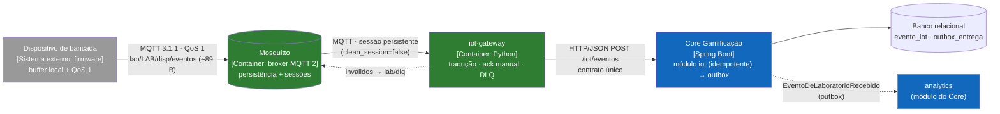

**Rastreabilidade:** RF06 → conectividade intermitente, eficiência, interoperabilidade → ASR-12/13/14 + RPCs (dispositivo fraco, rede instável, broker custa) → B vence A (dispositivo e Core acoplados, handshake por evento) e C (broker sem ASR) → ADR-005 → C4 Container com protocolos → lab com 6 cenários (0 perdas, 1 duplicata absorvida) + IOT-01..04 + pytest.

---

## Desafio 6 — CI/CD e observabilidade

**Cenário:** depois das decisões anteriores, a solução tem Core Java, serviço(s) Python, broker MQTT e componentes de integração. A arquitetura só se sustenta se a equipe conseguir testar, implantar e observar cada parte com segurança.

### 1. RF

Todos os RFs afetados pelos componentes construídos (RF01–RF06), mais a operação e a evolução da solução.

### 2. RNF (FURPS+)

| RNF | FURPS+ | Leitura no case |
|---|---|---|
| Observabilidade | S/+ | Saber, em produção, se as decisões dos ADRs continuam valendo |
| Deploy independente | S/+ | Prometido nos ADR-003 e ADR-005; sem pipeline próprio, fica só no papel |
| Confiabilidade | R | Nada quebrado pode chegar à homologação |
| Testabilidade | S | Os gates precisam ser automáticos e rápidos |
| Recuperabilidade | R | Deploy ruim precisa voltar sozinho |
| Desempenho | P | Gatilhos de latência (ranking, conclusão, IA) precisam ser medidos |

### 3. ASR (máx. 3)

| ASR | O que ele muda na arquitetura |
|---|---|
| **ASR-15 Deploy independente** | **Implantação:** um pipeline por componente com deploy próprio; mudança no `ia-service` não rebuilda nem reinicia o Core. |
| **ASR-16 Confiabilidade da entrega** | **Operação:** gates automáticos bloqueiam o deploy (testes, regras de arquitetura, cobertura do domínio, testes de alerta, smoke) e o smoke com falha faz rollback para a imagem `:estavel`. |
| **ASR-17 Observabilidade** | **Operação:** cada ASR crítico dos desafios anteriores ganha uma métrica e um alerta com o limiar do seu ADR. |

### 4. RPC

- Jenkins é a base da esteira.
- Prometheus/Grafana são as ferramentas do laboratório.
- Artefatos e configurações devem ser versionados (Jenkinsfiles, `prometheus.yml`, `alertas.yml`, dashboard JSON, provisionamento do Grafana, `docker-compose.yml`).

### 5. Decisão do Tech Lead

- **Serviços independentes exigem pipelines independentes?** **Sim, os que têm deploy independente por decisão arquitetural:** Core, `ia-service` e `iot-gateway`. Cada Jenkinsfile só executa se o próprio caminho mudou desde o último build verde (`git diff` no stage *Detectar mudanças*) e faz deploy com `docker compose up -d --no-deps <serviço>`. **Não** ganham pipeline o `notificacao-stub` (simula um terceiro) e as imagens de terceiros (Mosquitto, Prometheus, Grafana), que são versionadas por tag no compose.
- **O que deve bloquear o deploy?**

| Gate (stage) | Protege qual decisão | Componente |
|---|---|---|
| Testes de unidade + Cucumber (RN1–RN5) | Regras de negócio da AC1 (RPC do D2) | Core |
| `ArquiteturaModularTest` ARQ-01..05 | ADR-001 (fronteiras) e ADR-002 (domínio puro) | Core |
| JaCoCo: domínio 100%, projeto ≥ 95% linhas / ≥ 90% branches | ADR-002 (regra totalmente testada) | Core |
| `promtool test rules` | ADR-006 (alerta errado = cegueira) | Core/observabilidade |
| `pytest` | Contrato, degradação e idempotência dos serviços | ia-service, iot-gateway |
| Smoke test: health, `/ranking` e **métricas dos ADRs expostas** | Implantação saudável e observável | todos (rollback se falhar) |

- **Quais métricas validam os ASRs anteriores?**

| ASR / ADR | Métrica (Prometheus) | Alerta (limiar = decisão do ADR) | Painel no Grafana |
|---|---|---|---|
| ASR-02 / ADR-001 | `http_server_requests_seconds_bucket{uri="/ranking"}` | `RankingLento`: p95 > 300 ms por 5 min → **reavaliar separar o ranking** | p95 do GET /ranking |
| ASR-06 / ADR-003 | `ia_recomendacoes_total{origem}`, `ia_assistente_indisponivel_total`, `ia_latencia_segundos` | `IaDegradada`: > 5% saindo do catálogo padrão por 1 min → **circuit breaker** | % degradadas · por origem · p95 do ia-service |
| ASR-07/15 | `up{job}` | `ComponenteFora`: alvo sem resposta por 30 s | Componentes no ar |
| ASR-09/10 / ADR-004 | `http_server_requests_seconds_bucket{uri="/alunos/{id}/conclusoes"}` | — (deve ficar baixo mesmo com provedor fora) | p95 da conclusão |
| ASR-11 / ADR-004 | `outbox_entregas{status}`, `outbox_pendente_mais_antiga_seconds` | `NotificacoesRetidas` (> 120 s) · `OutboxComFalhaDefinitiva` (DLQ > 0) | outbox por status · idade da mais antiga |
| ASR-12 / ADR-005 | `iot_eventos_recebidos_total{resultado}`, `iot_retentativas_total`, `iot_fila_interna` | `IotGatewayRetendoEventos` | eventos IoT · retentativas e fila |

- **Como distinguir métrica técnica de evidência arquitetural?** Uma **métrica técnica** diz se o processo está saudável (CPU, heap, req/s, taxa de 5xx). Uma **evidência arquitetural** mede o **cenário de um ASR com o limiar escrito no ADR** e tem uma **ação** associada. Exemplo: `ia_recomendacoes_total{origem="catalogo_padrao"}` subindo não é "erro"; é o ADR-003 funcionando (degradação). Já passar de 5% por 1 minuto é o gatilho registrado para mudar a arquitetura (circuit breaker). Por isso todo alerta do `alertas.yml` tem a anotação `adr`.

### 6. Alternativas e trade-offs

| Critério | Pipeline único (tudo junto) | **Pipeline por componente** |
|---|---|---|
| ASR-15 Deploy independente | Não: mudar o RAG rebuilda e reinicia o Core | **Sim: só o componente alterado** |
| Tempo de feedback | Soma de todos os builds (Maven + 2 × pytest + 3 imagens) | **Só o que mudou** |
| Blast radius de um deploy ruim | Todos os componentes | **Um componente, com rollback próprio** |
| Custo | 1 Jenkinsfile | **3 Jenkinsfiles (mesma estrutura, ~100 linhas cada)** |
| Risco | — | Versões incompatíveis entre componentes. Mitigação: contratos testados dos dois lados (CT-IA, pytest do ia-service, IOT-01..04, pytest do gateway) |

Sobre a seleção de métricas: cada uma das escolhidas mede um cenário de ASR. Métricas genéricas (JVM, CPU) continuam expostas pelo Actuator, mas não viraram alerta porque não dizem nada sobre as decisões.

### 7. Mini-lab / evidência

**Hipótese:** o Jenkins bloqueia um deploy que viola uma decisão arquitetural, e uma condição provocada (IA parada) aparece como alerta com o ADR correspondente e se resolve sozinha quando o componente volta.

| Evidência | Resultado | Arquivo |
|---|---|---|
| Suíte do Core (o que o stage *Build + testes + gates* roda) | **91 testes, 0 falhas** | [`testes-core-final.txt`](evidencias/desafio-06/testes-core-final.txt) |
| Gate de cobertura | **100% linhas e branches** (gate: domínio 100%; projeto 95%/90%) | [`jacoco-gate.txt`](evidencias/desafio-06/jacoco-gate.txt) |
| Gate de regras de alerta | `promtool check` + **4 testes unitários de alerta** (IA fora → `ComponenteFora` + `IaDegradada`; IA saudável → nenhum; outbox parado → `NotificacoesRetidas`; Core fora → `IotGatewayRetendoEventos`) | [`promtool-validacao.txt`](evidencias/desafio-06/promtool-validacao.txt) |
| Gate de arquitetura bloqueando | Violação proposital (`@Entity` no domínio) → ARQ-04 falha → `mvn verify` falha → stage vermelho, sem deploy | [`arq-04-violacao-dominio.txt`](evidencias/desafio-02/arq-04-violacao-dominio.txt) (mesmo teste do pipeline) |
| Condição provocada: `ia-service` parado com tráfego (stack completa) | Os 3 alvos `up` → IA parada: `ComponenteFora` **FIRING em ~50 s** e `IaDegradada` (> 5% no catálogo padrão) **FIRING em ~90 s** → IA religada: os dois **resolvidos em ~70 s**, sem intervenção | [`lab-alerta-ia-parada-completo.txt`](evidencias/desafio-06/lab-alerta-ia-parada-completo.txt) · validação inicial só com Prometheus: [`lab-alerta-ia-parada-parcial.txt`](evidencias/desafio-06/lab-alerta-ia-parada-parcial.txt) |

> **Evidências visuais a capturar com a stack completa:** prints do Jenkins (3 jobs, build bloqueado pelo ARQ-04, deploy só de um componente) e do Grafana/Prometheus (dashboard em vermelho e recuperado, alertas FIRING/resolvidos). O passo a passo e os nomes dos arquivos estão em [`CHECKLIST-PRINTS.md`](CHECKLIST-PRINTS.md).

### 8. ADR + C4

#### ADR-006 — Pipeline Jenkins por componente com gates arquiteturais + métricas e alertas ligados aos ADRs

- **Status:** Aceito.
- **Contexto:** a solução tem 3 componentes nossos com deploy independente e 3 componentes de infraestrutura; as decisões anteriores têm gatilhos que precisam ser medidos.
- **ASRs/RPCs:** ASR-15, ASR-16, ASR-17 · Jenkins, Prometheus/Grafana, tudo versionado.
- **Alternativas:** pipeline único × pipeline por componente; métricas técnicas genéricas × evidências arquiteturais.
- **Decisão:** três Jenkinsfiles (`Jenkinsfile`, `servicos/ia-service/Jenkinsfile`, `servicos/iot-gateway/Jenkinsfile`) com detecção de mudança, gates bloqueantes, imagem com tag do commit, deploy `--no-deps`, smoke e rollback para `:estavel`. Core com Actuator + Micrometer (`/actuator/prometheus`); métricas arquiteturais publicadas por cada módulo (`MeterBinder` em `recomendacao`, `eventos` e `iot`); serviços Python com `prometheus_client`. Prometheus com 3 jobs e 6 alertas anotados com o ADR; Grafana provisionado com o dashboard **"Arquitetura B1 – evidências dos ADRs"** (10 painéis). O gate de cobertura passa de "100% em tudo" para **100% no domínio e 95%/90% no projeto**, porque o rigor máximo fica onde está a regra.
- **Consequências:**
  - (+) a promessa de deploy independente (ADR-003/005) passa a ser verificável; quebrar uma fronteira bloqueia a entrega.
  - (+) cada gatilho de reavaliação (ranking, circuit breaker, outbox) é um alerta, não uma lembrança.
  - (−) 3 pipelines para manter; Jenkins com acesso ao Docker do host (aceitável só em laboratório).
  - (−) os gauges do outbox consultam o banco a cada *scrape* (10 s); com volume alto, trocar por contadores incrementais.
  - (−) contratos entre componentes testados dos dois lados, mas sem *contract testing* formal (Pact): fica para a AF.

#### C4 — Deployment (laboratório, `docker compose`)

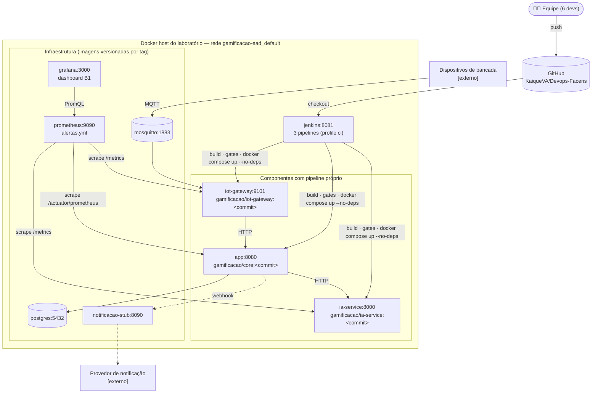

**Rastreabilidade:** RF01–RF06 + operação → deploy independente, confiabilidade, observabilidade → ASR-15/16/17 + RPCs (Jenkins, Prometheus/Grafana, versionado) → pipeline por componente vence pipeline único; evidência arquitetural vence métrica genérica → ADR-006 → C4 Deployment → gates (91 testes, ARQ, JaCoCo, promtool) + `ComponenteFora` e `IaDegradada` provocados e resolvidos na stack completa.

---

## C4 final — Container

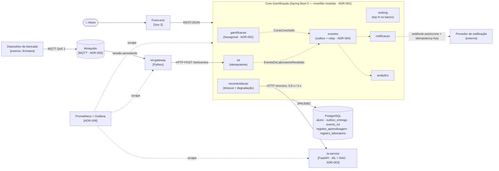

## Achados dos labs

| # | Achado | Onde | O que mudou por causa dele |
|---|---|---|---|
| 1 | No perfil `memoria` o ranking ficou vazio | D2 | Confirmou o acoplamento de schema do ADR-001; virou gatilho (projeção por eventos) em vez de defeito escondido |
| 2 | Com a IA lenta, **cada** requisição espera o timeout inteiro (0,81 s) | D3 | Alerta `IaDegradada` (> 5%) como gatilho para circuit breaker |
| 3 | O provedor externo simulado não lia corpo `chunked`, que é o formato que o `RestClient` envia | D4 | Teste de contrato no stub; lição: integração com terceiro precisa de teste dos dois lados |
| 4 | Testes do outbox instáveis: contextos Spring compartilhavam o mesmo H2 e o relay agendado de um contexto mexia nos dados de outro | D4 | `src/test/resources/config/application.properties`: H2 por contexto e relay agendado desligado nos testes |
| 5 | QoS 1 gerou reentrega real no lab (mesmo `eventoId`) | D5 | Idempotência no Core comprovada (`DUPLICADO`, sem efeito) |
| 6 | Modo síncrono de notificação: provedor fora → **500 e conclusão perdida** | D4 | Medida que sustenta a rejeição da alternativa A no ADR-004 |

## Como executar

```bash
cd gamificacao-ead

# build completo com todos os gates (o mesmo do Jenkins)
./mvnw clean verify

# stack completa: Core, PostgreSQL, IA, provedor de notificação, Mosquitto, gateway, Prometheus e Grafana
docker compose up -d --build
#   Core/Swagger  http://localhost:8080/swagger-ui.html
#   Prometheus    http://localhost:9090/alerts
#   Grafana       http://localhost:3000  (admin/admin) → dashboard "Arquitetura B1"
docker compose --profile ci up -d jenkins   # Jenkins em http://localhost:8081 (ver ci/README.md)

# labs (cada um imprime o resultado; no Windows use o Git Bash)
python labs/desafio-01/analisar_dependencias.py src/main/java
bash labs/desafio-02/executar-lab.sh
bash labs/desafio-03/executar-lab.sh
bash labs/desafio-04/executar-lab.sh            # e: EVENTOS_ENTREGA=sincrona docker compose up -d app && bash labs/desafio-04/executar-lab.sh sincrono
bash labs/desafio-05/executar-lab.sh
bash labs/desafio-06/executar-lab.sh

# testes dos serviços Python
cd servicos/ia-service && pip install -r requirements-dev.txt && pytest
```

## Síntese final: o que vai para a PoC da Avaliação Final

| Decisão | Vai para a PoC? | Como |
|---|---|---|
| ADR-001 Monólito modular | **Sim** | Base do Core; `ArquiteturaModularTest` continua sendo o guardião das fronteiras |
| ADR-002 Hexagonal no módulo que muda | **Sim** | Novas regras (badges, recompensas) entram em `gamificacao.domain` com teste de contrato das portas |
| ADR-003 IA como serviço com degradação | **Sim** | Plugar um LLM real em `rag.gerar_resposta` e medir; circuit breaker se o alerta `IaDegradada` disparar |
| ADR-004 Outbox sem broker | **Sim** | Acrescentar `SKIP LOCKED` para várias instâncias e expurgo de `ENTREGUE`; RabbitMQ só no 2º consumidor externo |
| ADR-005 MQTT + gateway | **Sim** | Produção: TLS 8883 + credencial por dispositivo + ACL por tópico |
| ADR-006 Pipelines por componente + alertas ligados a ADRs | **Sim** | Acrescentar contract testing (Pact) entre Core ↔ ia-service ↔ gateway |

**Pendências conscientes (gatilhos monitorados):** projeção própria do ranking (ADR-001), circuit breaker (ADR-003), broker interno (ADR-004).
